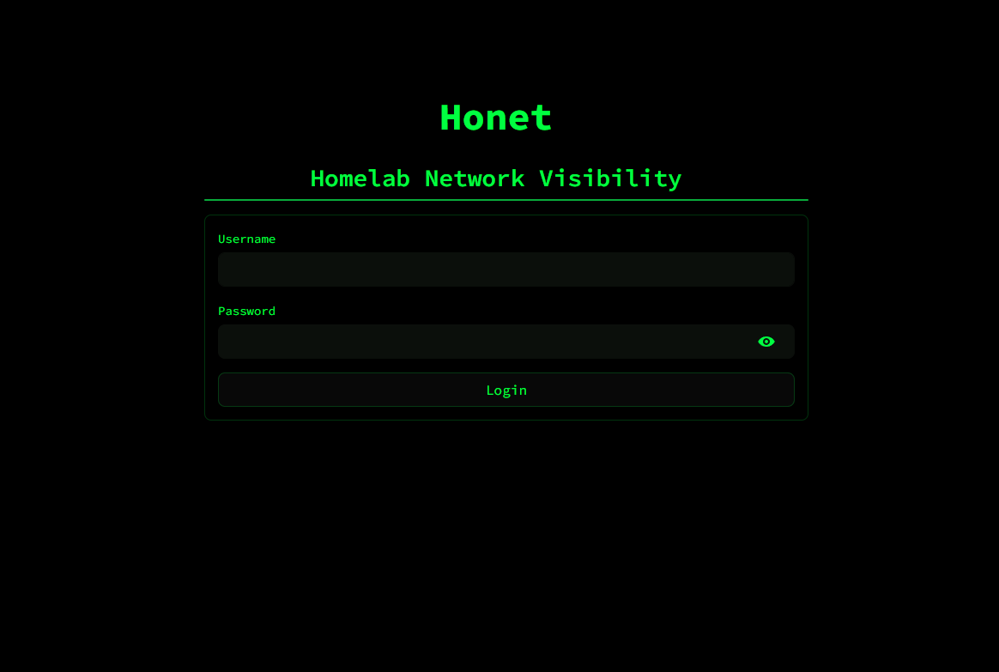
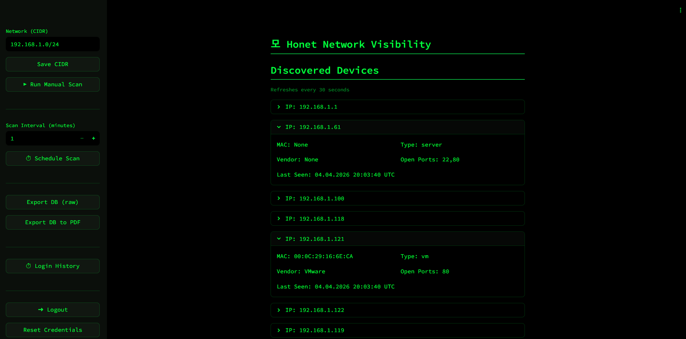
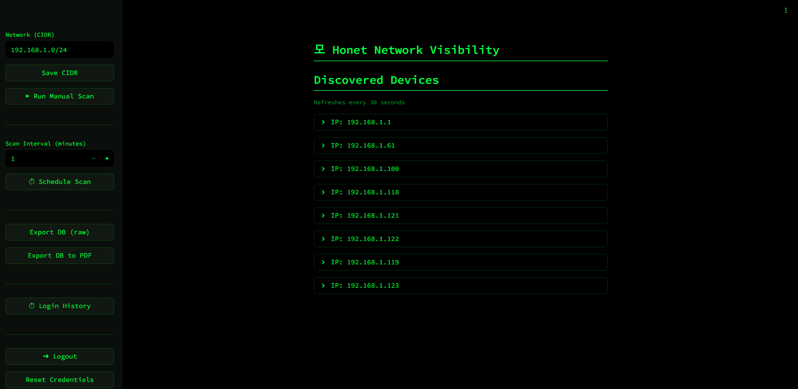
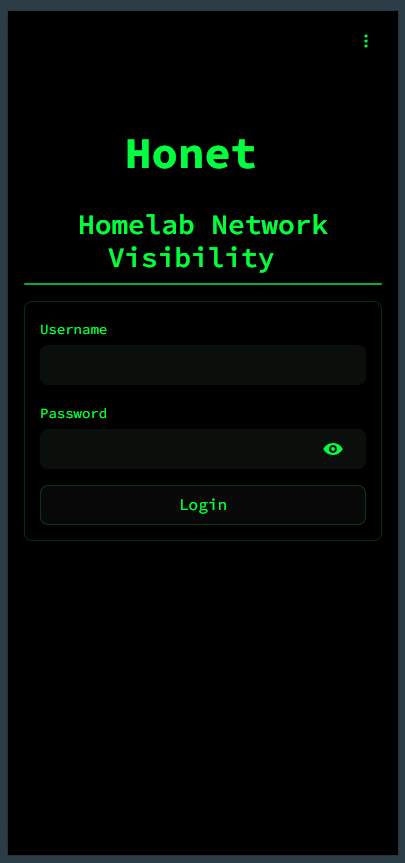
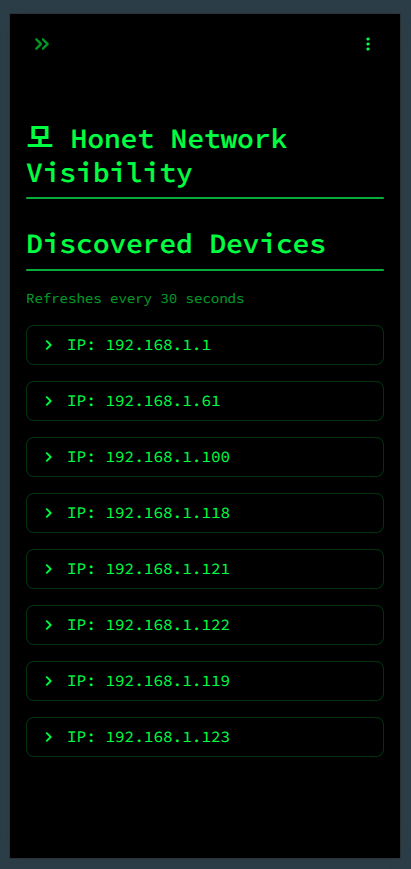
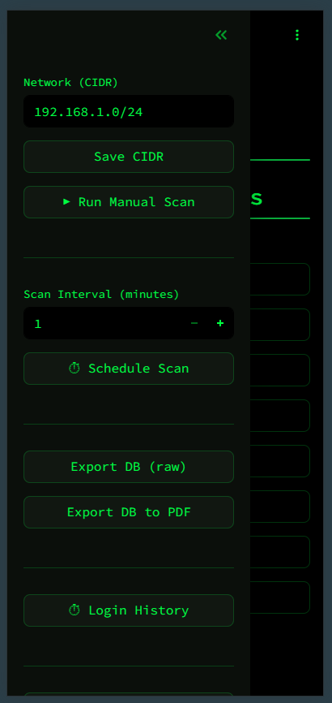

# HONET

Honet is a lightweight homelab network monitoring tool with Nmap scanning and Streamlit dashboard

---

## 🧰 Current Tech Stack

- Python 3.12.13
- Streamlit 1.55.0  
- SQLite 3.45.1  
- Nmap 7.94SVN

## 🖥 Development Platform

- 🐧 Ubuntu 24.04.3 LTS (Noble Numbat)

---

## 🔐 Features

- 📡 Network Discovery
    Identify active devices within custom CIDR ranges using ARP-based scanning.
- 🚪 Port Detection
    Detect open ports with a built-in (limited) scanning capability.
- 🧠 Device Classification
    Automatically categorize discovered devices based on observed characteristics.
- 🗂 Forensic Logging
    Store all scan data in a SQLite database, accessible through the web portal.
- 🔒 Authentication & Protection
    Secure login system with session-based brute-force protection.
- 🛑 Session Management
    Automatic session timeout to reduce unauthorized access risk.
- ⏱ Scheduled Scanning
    Configure periodic scans for continuous monitoring.
- 🔐 SSL / HTTPS Support
    Supported via Streamlit, though not recommended due to security and performance limitations.
- 📤 Data Export
    Generate PDF reports and export raw database files.
- 🐳 Docker Support
    Containerized deployment, optimized for low-resource environments (e.g., Raspberry Pi Zero W).
- 🤳 Mobile-Friendly UI
    Responsive interface enabled by Streamlit for access across devices.

---


## 👟 How It Runs

- User Setup
    Create an account to gain access to the system.
- Target Configuration
    Define network ranges using CIDR notation.
- Scanning Process
    Execute Nmap scans either manually or via scheduled tasks.
- Data Storage
    Persist scan results in a SQLite database.
- Visualization
    Explore and analyze results through a Streamlit-based interface.
- Report & Investigation
    Get raw database or generate PDF report.
- Optional Logging Layer
    Integrate a reverse proxy to capture and log incoming IP addresses.

## ⛔ Limitations

- Docker environment may not detect all devices (especially mobile)
- For full network visibility, run on host system

## 🛡️ Security

- Runs locally by default
- Reverse proxy recommended for public exposure
- No sensitive data stored

## 📸 Screenshots

### 🖥 Web UI

<p align="center">
  
</p>

<p align="center">
  
</p>

<p align="center">
  
</p>


### 📱 Mobile UI

<p align="center">
  <a href="docs/images/mobile-login.png">
    
  </a>
  <a href="docs/images/mobile-main.png">
    
  </a>
  <a href="docs/images/mobile-menu.png">
    
  </a>
</p>

---

## 🚀 How To Run

Execute the commands below:

1. `git clone https://github.com/AliSerifDemiralp/Honet.git`
2. `cd Honet`
3. `python3 -m venv .venv`
4. `source .venv/bin/activate`
5. `pip install -r requirements.txt`
6. `nohup streamlit run app.py --server.address 127.0.0.1 --server.port 8501 > honet.log 2>&1 &`

<details><summary>⚠︎ Recommended Steps</summary>

🚩 Nginx Setup (Recommended)

1. `sudo apt update`
2. `sudo apt install nginx -y`

Configure Reverse Proxy

3. `sudo nano /etc/nginx/sites-available/honet`
```
server {
    listen 80 default_server;
    server_name _;

    location / {
        proxy_pass http://127.0.0.1:8501;

        proxy_set_header Host $host;
        proxy_set_header X-Real-IP $remote_addr;
        proxy_set_header X-Forwarded-For $proxy_add_x_forwarded_for;

        proxy_http_version 1.1;
        proxy_set_header Upgrade $http_upgrade;
        proxy_set_header Connection "upgrade";
    }
}
```

Enable Configuration

4. `sudo rm -f /etc/nginx/sites-enabled/default`
5. `sudo ln -s /etc/nginx/sites-available/honet /etc/nginx/sites-enabled/`
6. `sudo nginx -t`
7. `sudo systemctl restart nginx`


🚩 Firewall (Recommended)

Allow only HTTP/HTTPS:

1. `sudo ufw allow 80`
2. `sudo ufw allow 443`
3. `sudo ufw deny 8501`
4. `sudo ufw enable`

Client IP Detection

- Honet uses reverse proxy headers to detect client IP addresses.
- Without Nginx (or another proxy), the application may only see "localhost"

Notes:
- Streamlit runs on 127.0.0.1:8501
- Nginx exposes the app on port 80
- HTTPS (port 443) can be added later with a valid certificate
- Self-signed SSL is not included by default

</details>

---

## 🐳 For Docker

`docker compose -f deploy/docker/docker-compose.yml up -d`

---

## 🧪 Improvements (Not Scheduled)
- Telegram Uptime Notifications
- Rule Management