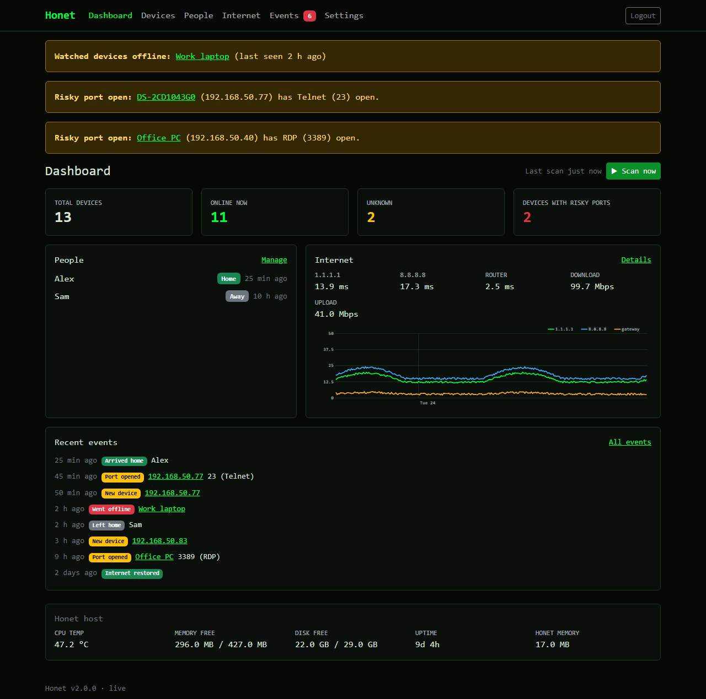
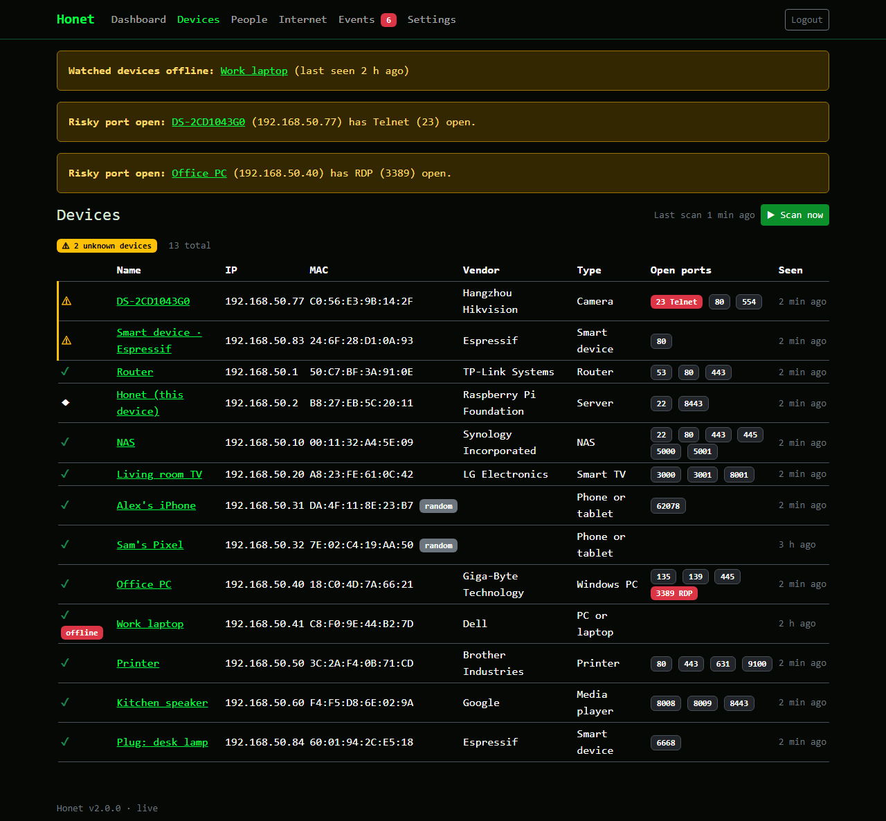
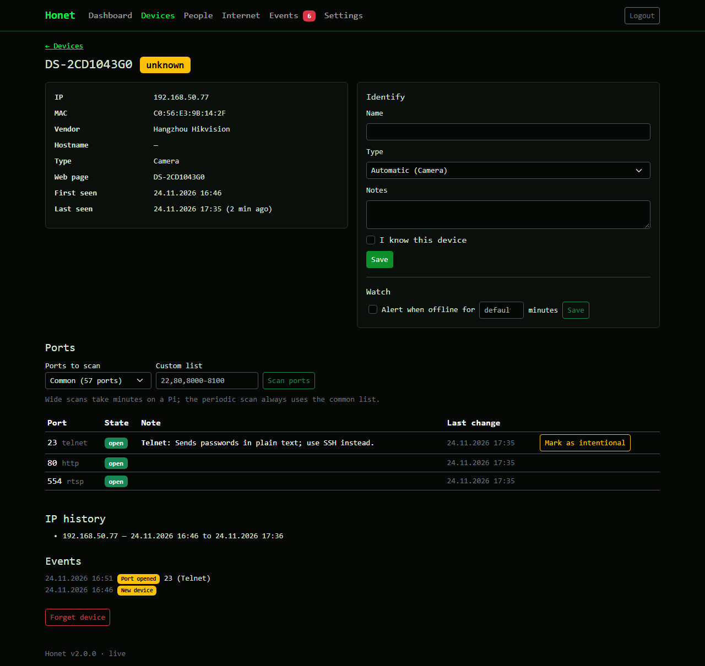
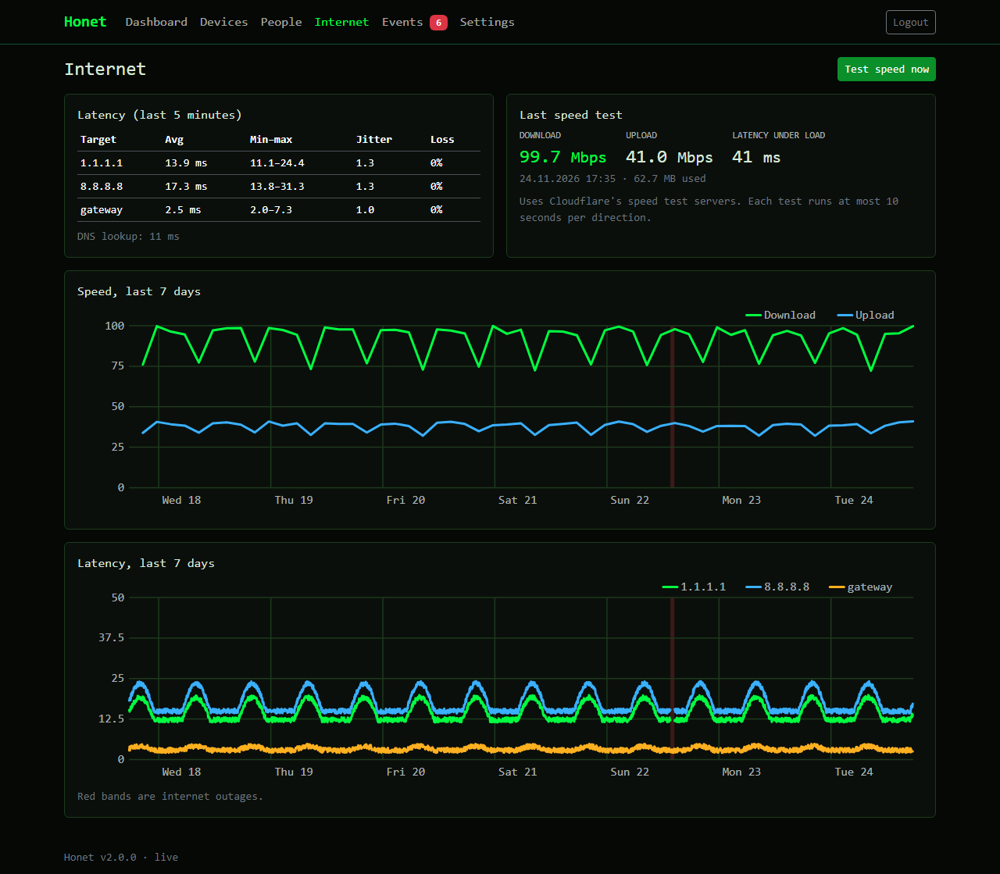
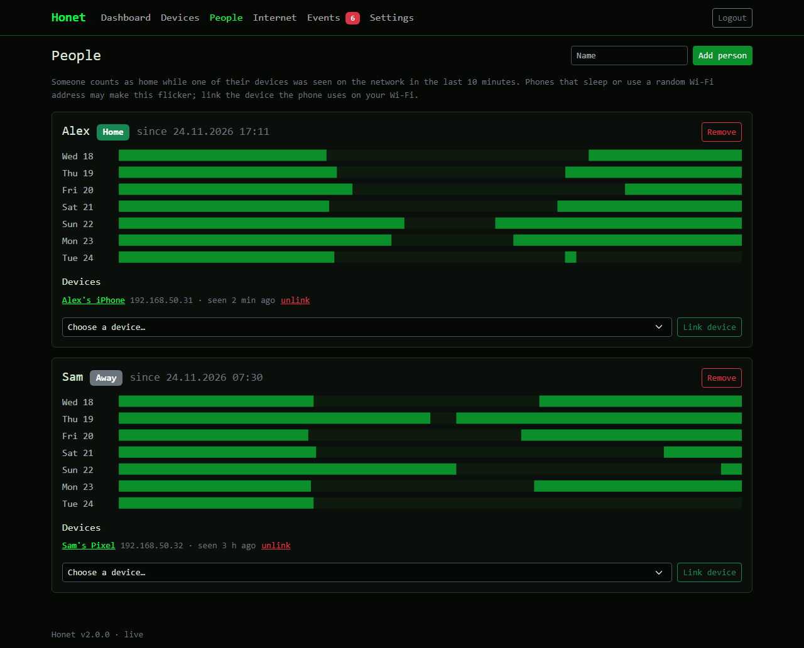
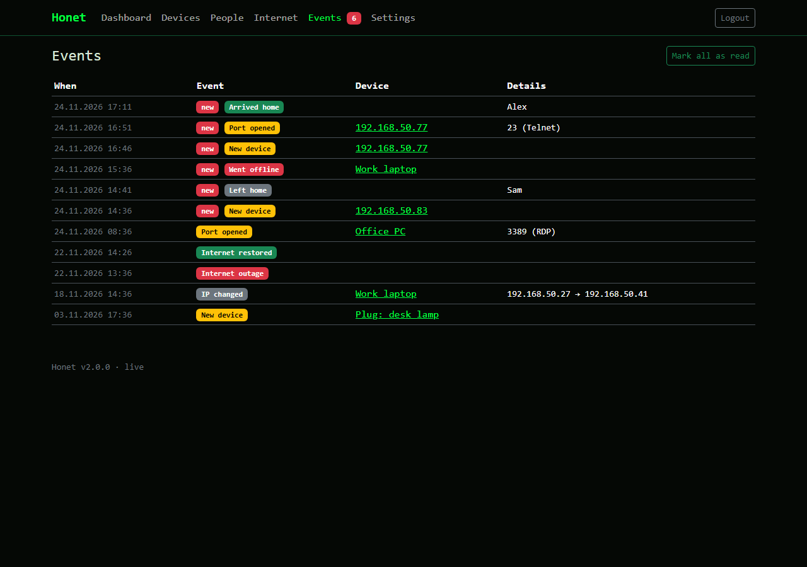
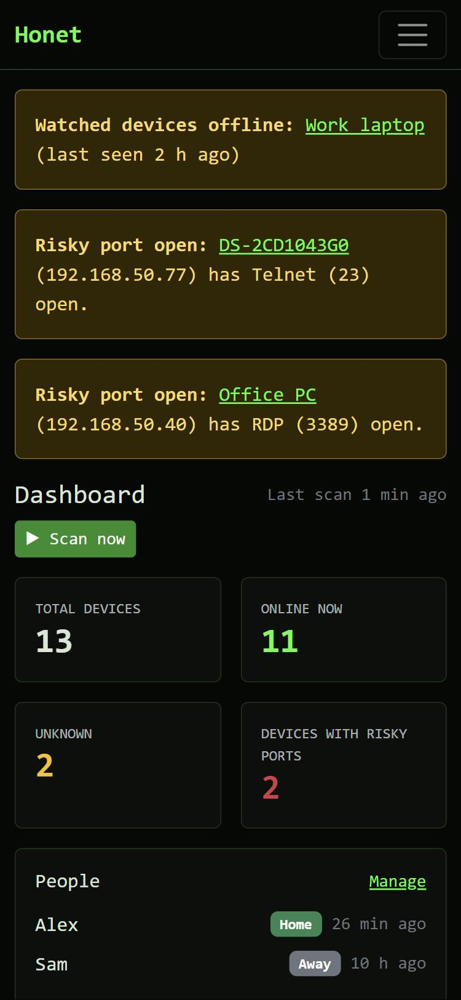

# Honet

**A tiny home network monitor for the Raspberry Pi Zero W.**

Honet answers one question: *which devices are on my network, and should they
be there?* It is a single static Go binary (about 15 MB) that runs on a
first-generation Raspberry Pi Zero W (ARMv6, 512 MB RAM) with no Python, no
nmap and nothing to install from the package manager. Open its web page from
your phone and you see every device, what it probably is, which ports it has
open, who is home and how your internet connection is doing.



> All screenshots use made-up demo data.

## Contents

- [Features](#features)
- [Screenshots](#screenshots)
- [Quick start](#quick-start)
- [Install on a Raspberry Pi](#install-on-a-raspberry-pi)
- [Run with Docker](#run-with-docker)
- [Build from source](#build-from-source)
- [First run](#first-run)
- [Using Honet](#using-honet)
- [Settings](#settings)
- [Command-line reference](#command-line-reference)
- [Data and privacy](#data-and-privacy)
- [Security](#security)
- [Troubleshooting](#troubleshooting)
- [Development](#development)

## Features

- **Device inventory.** Finds every device on your subnet every 5 minutes with
  ARP (or with ping and TCP probes for subnets the Pi is not attached to).
  Each device gets its vendor (from an embedded IEEE OUI table, no internet
  needed), hostname (reverse DNS or NetBIOS) and the title of its web page if
  it has one.
- **Device identification.** Honet guesses what each device is: router, phone
  or tablet, Windows PC, Apple device, NAS, printer, camera, smart TV, media
  player, server, smart device and more. Unnamed devices are shown by the best
  name available, such as `Archer AX55` or `Camera · Hangzhou Hikvision`,
  never as a bare question mark.
- **Unknown device alerts.** New devices stay flagged until you name them and
  mark them as known.
- **Port scans.** Every device is checked for 57 common TCP ports when it
  appears, when its IP changes and every hour. From a device's page you can
  also run a wider scan: well-known ports (1-1024), extended (1-10000), all
  65535 ports, or your own list such as `22,80,8000-8100`. A running scan can
  be stopped.
- **Risky port warnings.** Telnet, FTP, SMB, RDP, VNC, SNMP and exposed
  databases (MySQL, PostgreSQL, MongoDB, Redis, Elasticsearch, …) are shown
  in red with a one-line explanation until you mark them as intentional.
- **ARP spoofing and IP conflict alerts.** Warns when the router's MAC address
  changes or two devices claim the same IP address.
- **Watchlist.** Get an alert when a device you care about has been offline
  for longer than you allow.
- **Who is home.** Link people to their phones. Someone is home while one of
  their devices was seen in the last 10 minutes; a 7-day timeline shows when
  each person was home.
- **Internet monitoring.** Every minute Honet pings the router, `1.1.1.1` and
  `8.8.8.8` and keeps 5-minute summaries of latency, jitter, packet loss and
  DNS lookup time. When the internet stops answering but the router still
  does, an *Internet outage* is recorded. Every 3 hours a speed test runs
  against Cloudflare's speed test servers. The last 7 days are drawn as graphs.
- **Live dashboard.** The landing page puts devices, alerts, people, internet
  status, recent events and Pi health on one screen. Pages refresh themselves
  every 15 seconds; confirmations and errors use in-page dialogs.
- **Pi health.** CPU temperature, memory, disk, uptime and under-voltage
  warnings.
- **Events.** A timeline of everything that changed: new devices, IP changes,
  ports opening and closing, people arriving and leaving, outages.
- **Export.** Devices as CSV or JSON, and a printable report you can save as
  a PDF from the browser.

Alerts are shown in the web UI only. Honet does not send e-mail or push
notifications and has no cloud component.

## Screenshots

| | |
|---|---|
|  **Devices.** Unknown devices first, with vendor, guessed type and open ports. Risky ports are red. |  **Device page.** Identify a device, watch it, scan its ports with a chosen profile, see its history. |
|  **Internet.** Latency per target, the last speed test and 7-day graphs with outages marked in red. |  **People.** Who is home now and a 7-day timeline per person. |
|  **Events.** Everything that changed, newest first. |  **On a phone.** The whole interface works on small screens. |

## Quick start

| You have | Do this |
|---|---|
| A Raspberry Pi (any model) | [Install the release binary](#install-on-a-raspberry-pi) as a systemd service. Recommended. |
| A Linux machine with Docker | [`docker compose up -d`](#run-with-docker) with host networking. |
| Windows or macOS | Build from source to try the interface, or use Docker Desktop (it cannot see your real LAN, see below). |

Honet needs to sit on the network it watches. Run it on a machine that is
always on and connected to your home network (Wi-Fi or Ethernet).

## Install on a Raspberry Pi

Works on Raspberry Pi OS (Lite is fine), 32- or 64-bit, on every Pi from the
original Zero W to the Pi 5. The steps below run **on the Pi** over SSH.

**1. Download the release** for your Pi. Use `armv6` for the Pi Zero, Zero W
and Pi 1; `armv7` for the Pi 2 and 3 on 32-bit OS; `arm64` for 64-bit OS.

```sh
VERSION=v2.0.0
ARCH=armv6
BASE=https://github.com/AliSerifDemiralp/Honet/releases/download/$VERSION
mkdir -p ~/honet && cd ~/honet
for f in honet-linux-$ARCH install.sh honet.service sha256sums.txt; do
  wget -q "$BASE/$f"
done
sha256sum -c --ignore-missing sha256sums.txt
```

**2. Install it as a service:**

```sh
chmod +x install.sh
sudo ./install.sh
```

The installer:

- creates an unprivileged `honet` system user,
- copies the binary to `/usr/local/bin/honet`,
- installs and starts the `honet` systemd service,
- prints the address to open and a one-time **setup code**.

```text
honet is running: https://192.168.1.23:8443
(The certificate is self-signed; your browser will warn once.)
 HONET SETUP CODE: ABCD-EFGH-JKLM-NPQR
```

Then continue with [First run](#first-run).

**Upgrade:** download the new release and run `sudo ./install.sh` again. Your
data and settings are kept.

**Uninstall:** `sudo ./install.sh --uninstall`. This removes the service and
the binary but keeps your data in `/var/lib/honet`; the script prints the
command to delete it too.

**Installing from a PC instead:** if you built the binary yourself (see
[Build from source](#build-from-source)), copy it over together with the
installer and the unit file, then run the installer on the Pi:

```sh
scp dist/honet-linux-armv6 deploy/install.sh deploy/systemd/honet.service pi@raspberrypi.local:
ssh pi@raspberrypi.local 'chmod +x install.sh && sudo ./install.sh'
```

## Run with Docker

On a Linux host on your network (for example a Pi 4 with Docker installed):

```sh
git clone https://github.com/AliSerifDemiralp/Honet.git && cd Honet
docker compose -f deploy/docker/docker-compose.yml up -d
docker logs honet 2>&1 | grep -A2 "SETUP CODE"
```

Open `https://<host-address>:8443` and continue with [First run](#first-run).

The compose file pulls `ghcr.io/aliserifdemiralp/honet:latest` (built for
`linux/arm/v6`, `arm/v7`, `arm64` and `amd64`) and runs it:

- with **host networking**, because ARP discovery must see your real LAN,
- with every capability dropped except `CAP_NET_RAW` (needed for ARP and ping),
- with a read-only root filesystem and `no-new-privileges`,
- with a 96 MB memory limit,
- with its data in the `honet-data` volume.

**Docker Desktop (Windows/macOS)** runs containers inside a virtual machine.
Host networking there does not reach your LAN, so ARP only sees the VM.
You can still point Honet at your home subnet in Settings: it then finds
devices by ping and TCP probes through Docker's NAT, without MAC addresses or
vendors. That is fine for trying Honet, not for real monitoring.

```powershell
docker run -d --name honet -p 8443:8443 --cap-drop ALL --cap-add NET_RAW --read-only -v honet-data:/data ghcr.io/aliserifdemiralp/honet:latest
```

## Build from source

You need [Go](https://go.dev/dl/) 1.27 or newer. No C compiler is needed: the
binary is fully static.

On Windows (PowerShell):

```powershell
./build.ps1
```

This writes four binaries to `dist/`: `honet-linux-armv6`, `honet-linux-armv7`,
`honet-linux-arm64` and `honet-linux-amd64`.

On Linux or macOS, build one target at a time, for example the Pi Zero:

```sh
CGO_ENABLED=0 GOOS=linux GOARCH=arm GOARM=6 \
  go build -trimpath -ldflags "-s -w" -o dist/honet-linux-armv6 ./cmd/honet
```

To build the Docker image yourself:

```sh
docker build -t honet .
bash deploy/docker/smoke.sh linux/arm/v6   # build for the Pi Zero CPU and check it starts
```

## First run

1. Open `https://<pi-address>:8443` in a browser. The certificate is
   self-signed, so the browser warns once; accept it to continue.
2. Enter the **setup code** from the installer output, choose a username and a
   password of at least 10 characters.
3. Sign in. The first device scan starts immediately and the dashboard fills
   within a minute or two.
4. Go through the devices marked with ⚠. Open each one, give it a name, tick
   **I know this device** and save. Anything that stays unknown deserves a
   closer look.

Lost the setup code before finishing? Restart the service to get a new one:

```sh
sudo systemctl restart honet
journalctl -u honet | grep -A2 "SETUP CODE"
```

The setup code works only once. After the admin account exists, it can no
longer be used, and the account cannot be reset from the web page.

## Using Honet

**Dashboard.** Alerts at the top (router MAC changed, IP conflict, watched
device offline, risky ports, internet down), then device counts, people,
internet status, recent events and Pi health. *Scan now* starts a device scan.

**Devices.** All devices, unknown ones first. Click a device to:

- name it, choose its type, add notes and mark it as known,
- watch it: get an alert if it is offline for more than N minutes,
- scan its ports with a profile (*Common*, *Well-known*, *Extended*, *All* or
  *Custom*), and stop a scan that is running,
- mark a risky port as intentional (for example SMB on your NAS),
- see its IP history and events, or forget it.

Wide scans take a while on a Pi Zero (all 65535 ports of one device take
several minutes). The hourly scan always uses the common list.

**People.** Add a person and link the devices they carry. Phones that use a
private (random) Wi-Fi address per network keep the same address on your
network, so they work fine; phones that sleep their Wi-Fi may flicker
between home and away.

**Internet.** Current latency per target, the last speed test (*Test speed
now* runs one), and 7-day graphs. Red bands mark outages.

**Events.** Every change, newest first. Unread events are counted in the menu.

**Settings.** Scan range, intervals, internet monitoring, password, trusted
proxies, exports, the printable report and the last sign-in attempts.

### Scanning a different subnet

By default Honet scans the subnet of its own network interface. Under
Settings → *Scan range* you can enter another private range (for example
`192.168.0.0/24`). If that range is not directly attached, Honet finds
devices with ping and TCP probes instead of ARP; MAC addresses and vendors
are then unknown, and scans of a routed range are slower. Only private ranges
(10/8, 172.16/12, 192.168/16) of /22 (1024 addresses) or smaller are allowed.

### Internet data use

Each speed test direction stops after 10 seconds or 100 MB, whichever comes
first. On a Pi Zero W (about 25 Mbps over Wi-Fi) one test uses about 60 MB,
so the default interval of 3 hours uses about 0.5 GB a day. Change the
interval or set it to 0 to turn scheduled tests off; *Test speed now* still
works. Results close to the Pi's own limit are marked "may be limited by the
Pi".

## Settings

| Setting | Default | Notes |
|---|---|---|
| Scan range | the Pi's subnet | Private range, /22 or smaller |
| Interface | default route (e.g. `wlan0`) | |
| Device scan interval | 5 min | 0 = off |
| Port scan interval | 60 min | 0 = off; new and changed devices are scanned at once |
| Watch threshold | 15 min | Default for watched devices |
| Session timeout | 15 min | 5-240 min of inactivity |
| Trusted reverse proxies | none | Only then is `X-Forwarded-For` used |
| Speed test interval | 180 min | 0 = off, otherwise 60-1440 |
| Latency check interval | 1 min | 0 = off, otherwise 1-60 |
| Latency targets | `1.1.1.1, 8.8.8.8` | Up to 4 IP addresses; the router is always included |
| Pi speed limit | 25 Mbps | Results near it get a note |

## Command-line reference

```text
honet serve            run the web UI and scanners
honet reset-password   reset the admin password
honet version          print the version
```

| Flag | Environment | Default | Meaning |
|---|---|---|---|
| `--data-dir DIR` | `HONET_DATA_DIR` | `/var/lib/honet` | Database and certificate |
| `--db FILE` | | `DATA_DIR/honet.db` | Database file |
| `--listen ADDR` | `HONET_LISTEN` | `:8443` | Listen address |
| `--http` | | off | Plain HTTP instead of HTTPS |
| `--cert FILE --key FILE` | | self-signed | Your own TLS certificate |
| `--dev-assets DIR` | | | Read templates from disk (development) |

Examples:

```sh
honet serve --data-dir ./data                    # HTTPS on :8443 with a self-signed certificate
honet serve --http --listen 127.0.0.1:8080       # plain HTTP behind a reverse proxy
honet serve --cert cert.pem --key key.pem        # your own certificate
```

**Forgot the password?** Run this on the Pi, then restart to sign out every
session:

```sh
sudo -u honet honet reset-password
sudo systemctl restart honet
```

## Data and privacy

Everything lives in `/var/lib/honet` (mode 0700, owned by the `honet` user):

- `honet.db`: the SQLite database with devices, ports, events, people and
  presence history, latency and speed test results, settings, the admin
  account's bcrypt hash and recent sign-in attempts with their IP addresses.
- `honet-cert.pem`, `honet-key.pem`: the self-signed certificate.

Old data is pruned daily: events and speed tests after 90 days, latency
summaries and presence history after 30 days, sign-in attempts after 30 days.

The only traffic Honet sends outside your network is the latency pings and
the speed tests to Cloudflare. Both can be turned off in Settings. There is
no telemetry and the interface loads nothing from the internet.

## Security

- **One admin account**, created with a one-time setup code printed to the
  service log. There is no password reset over the web.
- **Passwords** are stored as bcrypt hashes; at least 10 characters.
- **Brute-force protection:** 5 failed sign-ins from one IP lock it for 10
  minutes, and a growing global delay slows down guessing from many IPs.
- **Sessions** live in server memory, use `HttpOnly`, `SameSite=Strict` and
  `Secure` cookies, and expire after 15 idle minutes. Background page refreshes
  do not keep a session alive. Changing the password signs out everyone.
- **Every form is CSRF-protected.**
- **Strict security headers:** a Content-Security-Policy without inline
  scripts or styles, `X-Frame-Options: DENY`, `nosniff`, `no-referrer` and HSTS
  over HTTPS. All assets, Bootstrap included, are embedded in the binary.
- **Untrusted text** from the network (hostnames, page titles, NetBIOS names)
  is length-limited, stripped of control characters and escaped.
- **`X-Forwarded-For`** is ignored unless the request comes from a proxy you
  listed in Settings.
- **Scans** are limited to private ranges of /22 or smaller. Port lists are
  validated and bounded.
- **Exports** contain devices only, never the account, password hash or
  sign-in history. The database does contain them, so protect its backups.
- **Least privilege:** the service runs as the `honet` user with only
  `CAP_NET_RAW`, in a hardened systemd sandbox (`ProtectSystem=strict`,
  `NoNewPrivileges`, private `/tmp`, restricted address families) with a 96 MB
  memory cap.

Honet is meant for your home network. Do not expose it to the internet.

## Troubleshooting

**No devices are found.** Check the error under the dashboard heading. ARP and
ping need `CAP_NET_RAW`; the systemd unit and the compose file grant it. Check
that the scan range in Settings matches your network (`ip -4 addr` on the Pi).

**Devices have an IP but no MAC or vendor.** The scan range is not directly
attached to Honet's interface, so it uses ping and TCP probes (typical in
Docker Desktop). Run Honet on a machine on that network.

**"Latency measurement is not available".** ICMP is blocked or `CAP_NET_RAW`
is missing. The rest of Honet works without it.

**The browser warns about the certificate.** Expected with the self-signed
certificate. Accept it once, or use your own with `--cert` and `--key`.

**The clock is wrong after boot.** A Pi without a real-time clock starts in
the past until it syncs with NTP. Honet waits for a sane clock before it scans
or records anything.

**See the logs:** `journalctl -u honet -f` (or `docker logs -f honet`).

## Development

```sh
go test ./...
go run ./cmd/honet serve --http --listen 127.0.0.1:8080 --data-dir ./data --dev-assets internal/web
```

`--dev-assets` reads templates and static files from disk on every request,
so you can edit them without rebuilding. Scanning and the Pi health card need
Linux; on Windows and macOS the interface runs but finds no devices.

Project layout:

```text
cmd/honet/            entry point: serve, reset-password, version
internal/scan/lan/    ARP discovery, ping/TCP sweep, port scans, NetBIOS and web page identification
internal/classify/    device type rules
internal/inventory/   devices, ports, events, people, internet results
internal/scheduler/   single-worker job queue (one scan at a time)
internal/netmon/      latency monitor
internal/speedtest/   Cloudflare speed test
internal/web/         HTTP server, templates and static files
deploy/               systemd unit, installer, Docker compose file
docs/superpowers/     design and implementation plans
```

Tagged versions (`v*`) are built by GitHub Actions: the four binaries,
`install.sh`, `honet.service` and `sha256sums.txt` are attached to the GitHub
release, and the multi-architecture image is pushed to
`ghcr.io/aliserifdemiralp/honet`.
